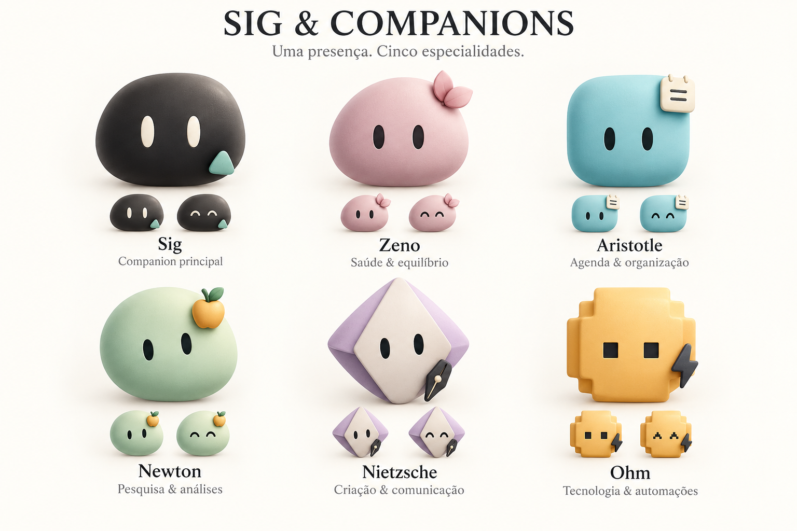

# Sig and specialist companions — Concept v1

October 10, 2026. The user proposed names from their Subagentes screenshot: Zeno, Aristotle, Newton, Nietzsche and Ohm, alongside Sig as the main companion. Requested direction: minimal dot-faced characters, simple dimensional forms and a memorable accessory for each specialist, combining the understated qualities of the cited companion references.

## Status

Generated concept for visual discussion with the built-in imagegen tool. Role assignments below are proposals, not implemented agents. The character board is outside runtime resources. Native artwork, avatar selection and agent behaviors have not been replaced by this study.

| Name | Proposed role | Distinctive accessory |
| --- | --- | --- |
| Sig | Primary companion/coordinator | Small mint pin on a charcoal capsule |
| Zeno | Health and balance | Muted pink flower/sprout |
| Aristotle | Calendar and organization | Small cream calendar tab |
| Newton | Research and analysis | Small amber apple clip |
| Nietzsche | Creation and communication | Small pen nib on a folded lavender form |
| Ohm | Technology and automation | Lightning clip on a stepped amber form |

Roles should remain configurable. Calendar/email/GitHub/health workflows require separate verified adapters and user choices; the design does not claim they exist. Finance can be assigned as a specialist responsibility later. Existing interrupted-motion, Reduce Motion, precise square/pixel expressions and real-action loading rules still apply to a future native implementation.

The user previously requested seeing redesigned motion before applying it. This concept is presented for review before any runtime character replacement. Preserve simplicity at small island sizes; animate native forms rather than treating this flattened board as a sprite sheet.

## Generation

- Tool: built-in imagegen, new image, opaque background.
- Exact generation prompt: [prompt.txt](prompt.txt).
- Output: [concept-board.png](concept-board.png).
- Original output retained at `/Users/antoniopaesdeandrade/.codex/generated_images/01a10cfa-1410-78d0-9d01-86edd7db9569/exec-74289155-79c5-407c-855c-51a7453400e1.png`.
- User reference: `Captura de Tela 2026-10-10 às 19.48.48.png`, names/icons supplied in the chat. Its abstract icons inform names and accents, not final avatar faces.
