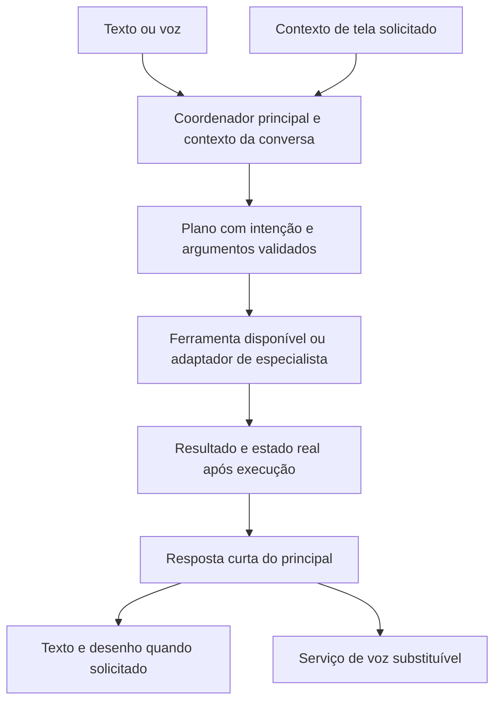

# Sieg: voz, contexto e ferramentas na arquitetura atual

Proposta de 20 de outubro de 2026. Responde à direção do usuário: o principal recebe perguntas, explica por áudio, desenha quando solicitado, conhece o estado real do Mac/app e executa ferramentas disponíveis. Não inicia uma sprint nem cria agentes/chats em paralelo.

## Responsabilidade

O principal do produto é **Sig**, conforme o contrato vigente; “Sieg” é o nome usado pelo usuário nesta conversa. Os papéis de desenvolvimento chamados Sieg em `Design/Workflow/README.md` são chats de implementação/revisão, distintos dos personagens em execução no produto. Esta proposta não renomeia personagens ou classes.

O principal coordena a interação e decide quando pedir uma ferramenta ou o contexto de um especialista. Os especialistas mantêm os domínios já definidos: Rita (saúde/pausas), Ada (código/GitHub), Gantt (rotina/calendário), Elinor (finanças/recursos), Toni (comunicação/arquivos). Cada domínio só anuncia capacidades com adaptador real disponível. Não é necessário criar seis chamadas de modelo para um pedido simples.

## Fluxo proposto

A evolução parte de `SpatialAssistantCoordinator`, `VoiceAppTools`, `SigVoiceSynthesizing` e dos ViewModels existentes. A lógica do Keep Awake, calendário e demais recursos continua nos seus respectivos serviços/ViewModels. O coordenador não deve reimplementar essa lógica nem transformar uma frase do modelo em prova de execução.

1. **Catálogo de ferramentas tipadas.** Cada ferramenta declara identificação, argumentos, disponibilidade, efeitos, resultado e erros. Exemplos: ativar/desativar/consultar Keep Awake, ler sistema, consultar tempo, desenhar e remover uma anotação. Os adaptadores chamam as funções reais existentes e leem o estado resultante.
2. **Planejamento estruturado.** Manter os comandos diretos e confiáveis como caminho rápido. Para variações e pedidos compostos, produzir um plano validado contra o catálogo disponível. A API concreta de planejamento deve ser comprovada no SDK/modelo Apple usado pelo app. O chat atual permanece Apple Foundation Models; não se reintroduzem Codex/Claude como runtime.
3. **Uma execução por interação.** Um identificador vincula reconhecimento, planejamento, chamadas, desenho e fala. Cancelar ou iniciar um novo pedido invalida resultados antigos. Etapas têm prazo e retorno visível; a animação reflete o trabalho real. A confirmação é composta a partir do resultado da ferramenta.
4. **Um contexto compartilhado.** Voz e texto devem usar a mesma conversa, preferências e resultados recentes, com orçamento limitado. O histórico de voz atual é separado e curto; memória compartilhada persistente ainda é trabalho futuro.
5. **Contexto visual sob demanda.** Ligar captura real autorizada a OCR/visão, com coordenadas e identificação da janela. O inspetor atual obtém metadados de acessibilidade sob o cursor; o método de OCR existente não comprova captura visual integrada. Só depois disso implementar instruções com destaques e avanço por etapa.
6. **Pesquisa com evidência.** A consulta meteorológica já usa um serviço real. A pesquisa genérica em segundo plano ainda gera um artefato fixo; precisa de busca/fetch, fontes e síntese antes de ser exposta como pesquisa concluída. `SystemCommandExecutor.confirmPendingAction` também não implementa a operação destrutiva anunciada; não registrar esse caminho como capacidade funcional.

## Voz e personalidade

`SigVoiceSynthesizing` é a fronteira de saída. O principal produz o conteúdo; um provedor de áudio o pronuncia. Trocar voz não requer outro agente ou mudar o fluxo de ferramentas.

Nesta entrega, o provedor nativo ganha seleção de voz instalada, tom, velocidade, volume, prévia e preferências persistidas. O padrão deixa de elevar o tom duas vezes. As instruções de conversa passam a permitir humor curto e leve quando adequado, preservando clareza em erros e temas sensíveis.

Foram geradas amostras locais dos perfis masculinos brasileiros `pm_alex` e `pm_santa` do Kokoro v1.0, para escolha de timbre. São uma avaliação, **não um backend já integrado ao aplicativo**. Uma integração distribuível precisa empacotar runtime/modelo/licenças, tratar carregamento fora da interface, memória, cancelamento e falhas, e passar pela mesma reprodução PCM segura existente. Não deve depender de Python ou arquivos temporários da máquina de desenvolvimento.

Fontes primárias: [vozes do Kokoro](https://huggingface.co/hexgrad/Kokoro-82M/blob/main/VOICES.md), [modelo e licença Apache 2.0](https://huggingface.co/hexgrad/Kokoro-82M), [runtime ONNX avaliado](https://github.com/thewh1teagle/kokoro-onnx).

## Critério de avanço

Avançar ferramenta por ferramenta, com evidência completa: entrada por texto/voz → argumentos corretos → efeito real → confirmação correta → fala e desenho encerram → cancelar/repetir não reaplica ações antigas. O primeiro conjunto é Keep Awake, estado do Mac e meteorologia. Depois, contexto visual real e tutoriais. Pesquisa genérica e operações sensíveis só entram quando os adaptadores executarem o que anunciam.

A proposta não afirma paridade com HeyClicky, nem substitui revisão independente ou aceite físico no Mac.
