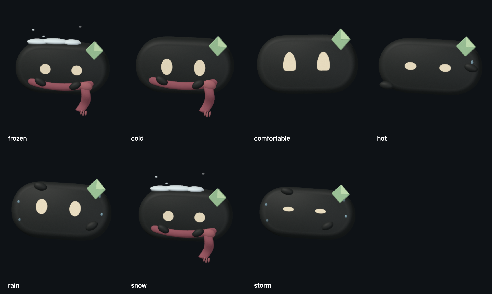

# Sieg — personagem climático nativo

21 de outubro de 2026. Entrega do especialista em avatares/animações, no checkout `MyDude/sieghart-spatial-assistant/Sieghart`. Componente implementado e probe isolado verificado. Integração, build completo e aceite no aplicativo ficam com a coordenação. A aparência ainda depende do aceite do usuário.

## Entrega e integração

Arquivo novo: [`CompanionWeatherCharacter.swift`](../../Sieghart/Shared/Components/Companion/CompanionWeatherCharacter.swift).

```swift
CompanionWeatherCharacter(
    mood: mood,
    animates: animates,
    previewTime: previewTime
)
.frame(width: 154, height: 156)
```

API de exportação, isolada no MainActor:

```swift
static func snapshot(
    mood: CompanionWeatherMood,
    time: Double,
    size: CGSize
) -> NSImage
```

`size` recebe pontos. O resultado contém bitmap com alpha a 2×, limitado a 1024 × 1024 pixels. A prévia para o tamanho combinado de 154 × 156 pontos resulta em 308 × 312 pixels. Tempos explícitos são normalizados a 24 amostras/s; tempo inválido usa zero, e tamanhos são limitados antes da conversão numérica.

Patch solicitado à coordenação: substituir o desenho antigo de `character(time:)` pelo componente acima e incluir o arquivo no target conforme a organização atual do projeto. A cena pai continua dona dos textos, da condição meteorológica e da precipitação global. Para uma prévia estática determinística, passar `previewTime`; para execução normal, deixar esse parâmetro como `nil`, mesmo que o pai tenha seu próprio relógio para a atmosfera. A view lê `islandPreview` diretamente e também funciona quando o pai define apenas esse ambiente.

Não houve edição de `CompanionWeatherScene.swift`, `CompanionRenderer.swift`, projeto Xcode ou testes compartilhados. Nenhuma alteração é necessária nos rigs existentes. Nenhum commit/push, novo worktree, build completo, app ou serviço foi iniciado por este trabalho.

## Identidade e material

O corpo, os olhos, o losango verde, as cores e os shaders de arredondamento vêm do `CompanionRigModel(.sig)` atual. A iluminação é `CompanionSceneLighting`; a superfície dos acessórios usa `rigMaterial`, incluindo o grão existente e resposta à iluminação física. Os olhos usam o cache de geometrias do modelo, com abertura e olhar reais. Não há substituição por outro personagem, SF Symbol, bitmap gerado ou decalque de acessório.

O cachecol coral é uma malha fechada: uma volta elíptica envolve o corpo em X/Z, cai mais na frente, e inclui nó volumétrico, ponta com curvatura em profundidade e franjas com espessura. Todos esses nós são filhos da cabeça, acompanhando encolhimento, inclinação e tremor. As mãos têm o material carvão do Sig e abraçam o tecido. O material mantém acabamento fosco; o cachecol não é uma `Capsule` colocada na frente de um retrato.

Neve acumulada, flocos próximos, condensação da respiração e gotas de contato são meshes pequenos. Neve/chuva da cena inteira continuam fora deste componente. O fundo do renderer é transparente; a prancha e o vídeo usam fundo escuro apenas para comparação. O personagem não ganha borda branca, gelo retangular ou painel luminoso.

## Catálogo e gatilhos

O gatilho comum é o `mood` fornecido pela observação meteorológica já resolvida no pai. As reações são ilustrações dessa condição; não são medição de sensação do usuário, evento de agente ou detecção individual de gotas/trovões. Este componente não busca localização/clima nem altera a prioridade de resolução dos moods.

| Mood | Intenção e pose | Repetição enquanto visível |
| --- | --- | --- |
| `comfortable` | Repouso satisfeito, olhos com expressão suave, inclinação mínima e olhar discreto. | Respiração pequena; piscar a cada 5,8 s; piscadela curta no ciclo de 9,5 s. |
| `cold` | Encolhimento leve, cabeça abaixada, mãos seguram o cachecol; gesto de tentar se aquecer. | Tremor em uma janela de 0,95 s a cada 7,8 s; condensação breve, separada do tremor. |
| `frozen` | Contração maior, olhos semicerrados, ombros/mãos recolhidos, neve sobre o corpo. | Tremor em uma janela de 1,45 s a cada 4,6 s, com intervalos; pequena expiração. |
| `snow` | Mesmo frio intenso, com acúmulo no topo e reação de olhar para os flocos antes de se recolher. | Ciclo de 4,6 s: tremor e depois olhar para cima por 1,1 s. |
| `hot` | Corpo um pouco caído, pálpebras pesadas, uma mão se abana e uma gota percorre a lateral. | Gesto de se abanar em uma janela de 2,8 s a cada 6,6 s; gota a cada 3,8 s. |
| `rain` | Inclinação defensiva, mão protege a testa, olhos procuram abrigo e gotas escorrem pelo corpo. | Sacudida curta de 0,85 s a cada 8,2 s; gotas locais reaproveitadas. |
| `storm` | Proteção mais fechada, contração e olhos mais estreitos; humor resignado. | Ciclo de 6,9 s com recolhimento por 1,2 s e uma sacudida breve. Sem flashes ou trovões artificiais. |

As reações não usam giro de corpo para loading nem cursor fictício. A troca de mood cancela a sequência anterior e interpola pose corporal/facial/mãos em 0,35 s a partir da última pose. Os acessórios correspondentes mudam com o mood; não há animação de vestir/despir. A primeira apresentação já começa na pose climática, sem repetir o alô aprovado ou modificar o onboarding.

## Pausas, custo e propriedade

- `animates == false`, `companionMotionEnabled == false`, Reduce Motion do sistema ou `islandReduceMotion`: uma imagem nativa da pose de repouso do mood, sem renderer contínuo. O cachecol e os sinais estáticos preservam o significado. `previewTime` permite escolher outra pose determinística para avaliação.
- `islandPreview == true` ou `previewTime != nil`: mesmo caminho de snapshot. `ImageRenderer` recebe uma imagem real, sem depender de desenhar `NSViewRepresentable`.
- Em produção, uma cena com um Sig, meshes reutilizados e limite solicitado de 24 fps. Nenhum `TimelineView`, relógio SwiftUI, emissor físico ou tarefa periódica nova no componente. As reações de frio, sacudida e abanar têm intervalos de repouso.
- `CompanionRenderView` existente pausa em desanexação, janela minimizada/oculta/ocluída e ancestral oculto. O mecanismo existente verifica ancestral oculto em até 0,5 s. Ao desmontar, libera delegate e cena. O relógio de pose avança somente nos callbacks e limita o salto após pausa; não reproduz todo o intervalo invisível.
- Mudanças SwiftUI escrevem apenas o mood em uma pequena caixa protegida por lock; o thread do renderer mantém propriedade dos nós durante a animação. A troca de mood não reconstrói a cena por frame.
- Snapshots: cache limitado a 14 imagens e aproximadamente 8 MiB de pixels RGBA. Um erro de exportação não é armazenado no cache; quando disponível, usa o retrato `Companion-sig` do bundle como fallback de identidade. Isso não substitui a validação de Metal no ambiente de exportação.

Não foi medido CPU/RAM do processo completo, nem estabelecido que 24 fps equivale a uma meta de CPU. A execução real, oclusão/minimização, alternância de Reduce Motion, cancelamento por fechamento e nitidez no tamanho real permanecem no aceite de integração.

## Evidência isolada

[Prancha dos sete moods](evidence/sieg-weather-character-2026-10-21/weather-character-board.png) · [Clipe nativo de 7 segundos](evidence/sieg-weather-character-2026-10-21/weather-character-motion.mp4) · [Prévia ImageRenderer a 2×](evidence/sieg-weather-character-2026-10-21/image-renderer-cold.png) · [Registro e hashes](evidence/sieg-weather-character-2026-10-21/probe-validation.json).



- Compilação isolada em Swift 6, Apple Swift 6.4, `-Onone`, concluída. O probe contém o componente exato entregue e o arquivo completo `CompanionRigGeometry.swift`. Usou recortes exatos dos enums, ambientes, SCNView, iluminação e shapes existentes; apenas o tipo de observação meteorológica foi substituído por um dado local, sem serviço. Isso verifica o componente, não todo o target. Fontes temporárias estão em `/private/tmp/sieg-weather-character-probe`.
- Sete snapshots nativos em 616 × 624 pixels foram inspecionados para forma, cor, volume, enquadramento e ausência dos acessórios planos antigos. A chamada de exportação usou 308 × 312 pontos para permitir revisão ampliada. O ImageRenderer no tamanho final de 154 × 156 pontos produziu 308 × 312 pixels e foi inspecionado separadamente.
- Pixels dos quatro cantos são transparentes nos oito PNG individuais. Seus limites alpha ficam dentro do quadro; a prancha tem fundo intencionalmente opaco. O primeiro probe, dentro do sandbox, não conseguiu obter bitmap Metal; a execução isolada com acesso à GPU produziu as evidências finais. O app não foi aberto.
- O clipe tem 168 quadros, 24 fps, 2464 × 736 pixels, duração 7 s, sem áudio. Reutiliza os rigs de frio, frio intenso, calor e chuva; não é gravação do app e não contém precipitação global. Os quadros 0 e 24 diferem nas áreas dos personagens, além das verificações numéricas das poses.
- As verificações do probe passaram para reutilização da imagem em cache, contração/tremor no frio, deslocamento da mão no calor, proteção da testa na chuva, olhar para cima na neve, renderer desanexado pausado e liberação de cena/delegate ao desmontar. Não foram executados suite compartilhada, modelo, conta ou serviço meteorológico.

## Proveniência e próximos critérios de aceite

Modelagem do cachecol, gestos climáticos e partículas locais são autoria nativa desta entrega, sobre a identidade e infraestrutura já existentes do Sieg. Referências visuais foram as três capturas fornecidas pelo usuário no Desktop (`20.29.12`, `20.29.17`, `20.29.23`, 21/10/2026), usadas para identificar o feedback rejeitado. A biblioteca v6 e as instruções do Workflow orientam preservação da identidade, transparência, limites e sinais de atividade reais. Nenhum novo código, arte, marca ou áudio de terceiros foi incorporado; as atribuições existentes do projeto continuam aplicáveis à infraestrutura reutilizada.

Aceite de integração: conferir os sete moods no frame combinado, chuva/neve do pai junto ao personagem, tamanho e hit testing dos controles, troca de mood e fechamento, pausa em janela escondida, Reduce Motion e preferências, qualidade Retina e CPU/RAM no app real. O componente não decide a prioridade de chuva/neve versus temperatura negativa no resolvedor atual; essa escolha pertence à cena/serviço responsável pelos dados.
