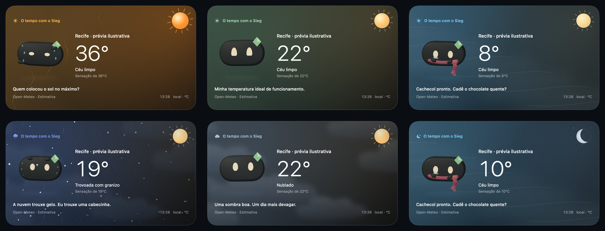

# Sieg — acabamento climático do painel

22 de outubro de 2026. Entrega no checkout `MyDude/sieghart-spatial-assistant/Sieghart`, retomada pelo usuário após a pausa para padronização global. Trabalho individual, sem subagentes, commit, push, instalação ou execução do app de produção. Foram alterados somente os dois componentes climáticos indicados, além deste relatório e suas evidências.

## Resultado

- Sol volumétrico maior, com disco de aproximadamente 40–50 pontos, raios que giram e pulso lento. Cor, tamanho e intensidade acompanham `feelsLike`; a posição permanece no canto superior direito. À noite, `isDay == false` coloca uma lua no mesmo canto, com luz fria. A área da localização e do botão de parar fala reserva esse espaço. Nenhum X foi acrescentado.
- Granizo com pequenas esferas iluminadas, queda mais rápida que neve e rebatimento no rodapé. O Sieg se abaixa e protege a cabeça com as próprias mãos. Chuva acompanhando uma trovoada com granizo permanece coerente com o código recebido.
- Céu nublado com camadas de nuvens em diferentes alturas, deslocamento horizontal e luz difusa pelo painel. O Sieg acompanha as nuvens com olhar e pose calmos. O efeito cobre a área inteira, com contraste menor na frente dos dados.
- Abaixo de zero, o próprio material do corpo ganha gelo gradualmente, começando pela periferia. Pequenos cristais geométricos crescem no contorno. Olhos, losango verde, corpo aprovado e cachecol continuam reconhecíveis. Não há caixa de gelo nem retângulo sobreposto. A recuperação remove o gelo e devolve o material original.
- Frio acima de zero recebe paleta azul, faixas suaves de ar frio e névoa/condensação em todo o painel. O cachecol e o tremor foram preservados. Frio sem código de neve não produz flocos.
- As seis gotas de suor mais visíveis, a reação de se abanar e as ondas verticais ascendentes do calor foram preservadas. Chuva e neve continuam atravessando todo o painel; apenas a borda externa faz o recorte da atmosfera.

## Arquivos e API

- [`CompanionWeatherScene.swift`](../../Sieghart/Features/DynamicIsland/Views/CompanionWeatherScene.swift): resolução dos moods, sol/lua, atmosfera, granizo, nuvens, ar frio e pausa do Canvas por visibilidade.
- [`CompanionWeatherCharacter.swift`](../../Sieghart/Shared/Components/Companion/CompanionWeatherCharacter.swift): poses de granizo/nublado, progressão do material gelado, cristais e recuperação.

A API existente continua válida. Foi acrescentado um parâmetro opcional `freezing` depois de `previewTime`, tanto no inicializador quanto em `snapshot(mood:time:size:freezing:)`. O valor padrão é `mood == .frozen`; a cena integrada fornece explicitamente `observation.temperature < 0`. Assim, neve/chuva/granizo e temperatura negativa podem coexistir sem perder o fenômeno recebido.

O cache de imagens inclui a condição de congelamento na chave, além de mood, tempo e tamanho; mantém o limite de 14 imagens e aproximadamente 8 MiB de pixels. Prévias a 154 × 156 pontos continuam gerando 308 × 312 pixels com alpha. Não foram acrescentados bitmaps aos recursos do app.

Não foram alterados `NotchWidgetViewModel`, `ScreenInteractionController`, `CompanionRenderer`, projeto Xcode ou testes compartilhados. A saída automática e a correção de transparência do renderer permanecem sob seus controladores atuais. As leituras dos arquivos existentes foram limitadas ao tamanho exato indicado pelo filesystem, evitando o bloqueio de leitura até EOF, sem alterar permissões/TCC.

## Dados e mapeamento

Conferido na [documentação primária do Open-Meteo — WMO](https://open-meteo.com/en/docs#weather_variable_documentation), em 22/10/2026. Os códigos 96 e 99 significam trovoadas com granizo; sua disponibilidade depende de modelos que forneçam essa previsão explicitamente. Não inferimos granizo a partir de temperatura, chuva ou trovoada comum.

| Entrada | Resolução |
| --- | --- |
| 96, 99 | Novo mood `hail` |
| 95, 97 | `storm`, sem granizo |
| 51, 53, 55, 56, 57, 61, 63, 65, 66, 67, 80, 81, 82 | `rain` |
| 71, 73, 75, 77, 85, 86 | `snow` |
| Sem precipitação, temperatura < 0 °C | `frozen` |
| Demais casos com sensação < 16 °C | `cold` |
| Demais casos com sensação ≥ 28 °C | `hot` |
| 2, 3, 45, 48 na faixa confortável | Novo mood `cloudy`; texto de nevoeiro preservado quando aplicável |
| Demais casos | `comfortable` |

A precipitação tem prioridade no mood; o congelamento usa a temperatura real separadamente. Os códigos de nebulosidade continuam determinando as nuvens mesmo quando a reação corporal é de frio/calor. `isDay` controla sol/lua; `feelsLike` controla o caráter térmico do sol e a atmosfera térmica. As faixas de ar frio são interpretação visual da condição, não uma medição de direção/velocidade do vento — esses valores não existem nesta observação.

## Movimento, cancelamento e custo

- O congelamento progride por 6,4 s de renderização visível e permanece no estado atingido. Ao deixar a condição abaixo de zero, o degelo leva 2,6 s. Mudar de mood mantém a interpolação de pose de 0,35 s. Gelo, olhos e acessórios usam nós/materiais persistentes; não criam meshes por quadro.
- Granizo: ciclo de proteção corporal de 4,8 s, com recolhimento de 1,1 s. Queda/rebatimento são trajetórias ilustrativas determinísticas, sem simulação física ou contato com dados do usuário. Nublado: olhar e inclinação lentos, acompanhando o deslocamento das nuvens.
- A cena e o personagem respeitam `animates`, `companionMotionEnabled`, Reduce Motion do sistema e `islandReduceMotion`. A atmosfera preserva um quadro estático; o personagem usa snapshot nativo. Um snapshot sem tempo explícito de condição congelante usa uma pose estática representativa, sem esperar o crescimento animado.
- O Canvas agora recebe o estado de visibilidade da janela por eventos nativos, sem timer novo: desanexação, fechamento, minimização e oclusão pausam o relógio. `onDisappear` também interrompe a apresentação. Callbacks de uma janela anterior são ignorados. O renderer do personagem conserva suas salvaguardas existentes.
- O relógio do personagem ignora saltos grandes entre callbacks; não simula o intervalo escondido. O relógio da atmosfera acumula somente tempo apresentado. A formatação do horário fica fora do fechamento de desenho do Timeline, evitando criar um DateFormatter por display tick.
- O renderer continua limitado a 24 fps. A atmosfera usa vetores e quantidades fixas de partículas; nuvens partem de um caminho pré-construído. Não há texturas grandes, novo timer por personagem ou processo de background contínuo. Custos reais de CPU/RAM do app não foram medidos.

## Validação isolada e evidências

[Prancha do painel](evidence/sieg-weather-finish-2026-10-22/weather-finish-board.png) · [Congelamento e recuperação](evidence/sieg-weather-finish-2026-10-22/freeze-recovery-board.png) · [Clipe silencioso de 7 s](evidence/sieg-weather-finish-2026-10-22/weather-finish-motion.mp4) · [Registro, dimensões e hashes](evidence/sieg-weather-finish-2026-10-22/validation.json).

- Compilação isolada em Swift 6/Debug concluída, usando os dois arquivos de produção exatos, cópias acessíveis de `Support.swift` e `CompanionRigGeometry.swift` preservadas pelo coordenador. O adaptador de verificações existe apenas na cópia temporária. As macros SwiftUI e as exportações Metal precisaram da execução local fora do sandbox; não houve mudança nas permissões do Mac.
- Passaram 16 cenários de resolução, incluindo 96/99, 95/97, negativos com chuva/neve/granizo e frio sem precipitação.
- O probe conduziu os callbacks do mesmo coordenador nativo: crescimento até o congelamento, pausa longa sem avanço artificial, recuperação completa em 2,6 s, chaves distintas de cache para neve com/sem congelamento, pausa em view desanexada e liberação de cena/delegate.
- Foram exportadas e inspecionadas 15 cenas a 2×, uma cena estreita com movimento desligado/ambiente reduzido e cinco quadros nativos da progressão/recuperação. Inspeção: enquadramento, volume, ausência de neve em céu limpo frio, frio no painel todo, dados legíveis, sol/lua e continuidade da chuva/neve. O marcador nativo de visibilidade é excluído dos exports ImageRenderer, que não desenham NSViewRepresentable; o conteúdo climático exportado é o de produção.
- O clipe usa os quatro painéis completos — granizo, nublado, calor e congelamento — em 70 amostras de tempo, 7 s, 10 fps, 1692 × 972 pixels, sem faixa de áudio. A cadência menor pertence apenas à exportação de comparação; produção solicita 24 fps. Foram inspecionados quadros do clipe. A área direita vazia de duas prévias nubladas apresenta diferença de pixels, confirmando deslocamento além da área do avatar.
- Todos os dados meteorológicos das prévias são fictícios e rotulados “prévia ilustrativa”; não são a previsão real de Recife. Não houve consulta a conta, microfone, áudio ou serviço meteorológico durante o probe.

Fontes/probes temporários: `/private/tmp/sieg-weather-finish-2026-10-22`. As capturas fornecidas pelo usuário (21/10, 21.51 e 22.10.19) orientaram o recorte pelo painel inteiro e a preservação de chuva/neve. As novas geometrias, poses e desenhos são nativos desta entrega, sem nova arte, áudio ou código de terceiros; as atribuições existentes da infraestrutura permanecem aplicáveis.

Limites: a suite geral não foi repetida, o app instalado não foi aberto ou substituído e os números anteriores de 360 testes/1115 execuções não são resultados desta entrega. O aceite no app real ainda deve conferir visibilidade/minimização/retorno, preferências de movimento, encerramento automático, botão de parar fala, diferentes escalas, nitidez Retina e CPU/RAM. A instalação permanece com a coordenação.
