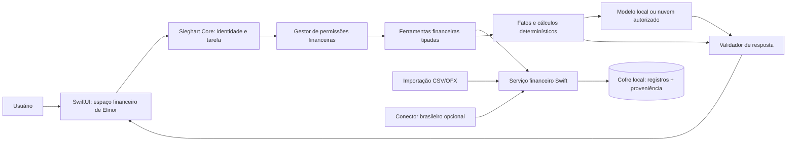

# Arquitetura do especialista financeiro do Sieghart macOS

**Estado:** proposta, sem implementação. **Data:** 13/10/2026. Base de evidência: [DeseretSaint](../applications/open-finance-deseretsaint.md), [openfinance-app](../applications/open-finance-openfinance-app.md), [comparação](../applications/open-finance-comparison.md) e [proposta de runtime](agent-runtime-comparison.md). O [mapa de responsabilidades do produto](../../Design/companion-capabilities.md#L3-L9) mantém **Sig como principal/orquestrador e Elinor como especialista financeira**; não criar outro nome ou mover a função para Ada/Toni. A intenção de um fluxo próprio do Sieg é preservada como **experiência nativa**; a infraestrutura bancária regulada depende de parceiro/participante autorizado, conforme [pesquisa brasileira](../integrations/brazilian-open-finance.md).

## Achados verificados que alteram o desenho

- `DeseretSaint` oferece tokens, escopos, pedidos de acesso e MCP, mas as regras por conta/tipo **não chegam a todos os caminhos** de transação e relatório. O Sieghart não pode confiar em filtro aplicado só ao listar ferramentas. [Dossiê §4](../applications/open-finance-deseretsaint.md#4-lacunas-de-segurança-verificadas-no-fluxo-de-código).
- `openfinance-app` tem entidades financeiras mais amplas, importação OFX/QIF/CSV e cálculo cambial por data; seu [`FinancialResponseGuard`](https://github.com/openfinance-app/open-finance/blob/c54668f6f9c36e0a4f9b6504d972661e4718a271/src/main/java/org/openfinance/service/ai/FinancialResponseGuard.java#L33-L139) força valores a virem de fatos tipados. A IA roda com dados do usuário, sem uma autorização granular própria para agente. [Dossiê §3](../applications/open-finance-openfinance-app.md#3-ia-exposição-a-agentes-e-permissões).
- Nenhum dos dois é aplicação macOS nativa nem prova conexão direta ao Open Finance Brasil. O segundo é ELv2, o que torna ainda mais importante implementar estrutura e interface originais. [Comparação](../applications/open-finance-comparison.md).

## Proposta: fluxo e fronteiras

**Separação proposta:** Sig reconhece intenção e abre a tarefa; Elinor define perguntas/visualizações financeiras; o serviço financeiro executa aritmética e consultas; o modelo produz texto, não valores de referência; o gestor de permissão decide acesso na execução. O modelo não recebe o arquivo de banco, a chave do cofre, tokens de agregador ou objeto de usuário irrestrito. A integração com OpenJarvis continua como **referência de orquestração**, sem processo Python/Java/Node obrigatório. [Comparação de runtime](agent-runtime-comparison.md).

### Modelo de dados mínimo proposto

| Tipo nativo | Campos essenciais e invariantes |
| --- | --- |
| `Money` | Valor decimal exato ou unidades menores + código ISO 4217. Não operar entre moedas distintas sem `FXQuote` válido. Escala da moeda e arredondamento definidos no cálculo, não pelo texto formatado. |
| `FinancialSource` | `sourceID`, tipo (`manual`, `CSV`, `OFX`, `regulatedProvider`), instituição declarada, proprietário, período coberto, data de importação/atualização e estado de consentimento. |
| `Account` | `accountID` interno, `sourceID`, tipo, moeda, saldo com `asOf`, ativo/inativo. IDs externos ficam no adaptador e são protegidos; não usar nome da conta como identidade. |
| `Transaction` | ID estável interno e ID externo/assinatura de deduplicação, conta, data contábil e data de evento, valor/moeda, sinal canônico, tipo, categoria, beneficiário, referência à origem, indicador de estorno/transferência e estado de conciliação. |
| `Budget`, `RecurringItem`, `Installment`, `SavingsGoal` | Distintos: limite por período/categoria; ocorrência prevista; parcela de compra com contrato/índice/total; meta com alvo/data. Dívida amortizada é outro tipo, não sinônimo de parcela de cartão. |
| `AssetPosition`, `Liability`, `Valuation` | Quantidade/custo/valor/data/fonte; não interpretar saldo de conta de investimento como posição detalhada; patrimônio deve evitar dupla contagem de ativo representado por conta. |
| `FXQuote` | Par, taxa, instante de referência, fonte, status (`observada`, `estimada`, `desatualizada`). Totais convertidos mostram essas informações. |
| `ConsentGrant`, `AgentDecision`, `AuditEvent` | Escopos, contas permitidas, prazo, origem, ato de aprovação, revogação, versão da política, tarefa e resultado. Ver [segurança](financial-data-security.md). |

**Inferência apoiada nos repositórios:** modelos distintos para recorrência, parcela, dívida e posição evitam respostas incorretas quando a fonte só fornece transações. A conversão por data e falha explícita quando faltar taxa seguem o padrão verificado de [`ExchangeRateService`](https://github.com/openfinance-app/open-finance/blob/c54668f6f9c36e0a4f9b6504d972661e4718a271/src/main/java/org/openfinance/service/ExchangeRateService.java#L99-L196), como conceito e não código copiado.

## Contrato de resposta para Elinor — proposta

Cada resposta financeira usa registros autorizados e devolve: **pergunta normalizada, contas incluídas, intervalo, moeda, dado observado ou estimado, data da fonte, método de cálculo, ausências e referências internas dos fatos**. O texto pode explicar um resultado, mas os números da UI são preenchidos por dados tipados após validação. Se a pergunta exceder o escopo concedido, pedir ampliação específica; se faltar dado, dizer o que falta. Texto de beneficiários, memos e extratos é dado não confiável, jamais instrução ao agente.

| Pergunta | Cálculo permitido e condição de resposta |
| --- | --- |
| “Quanto gastei este mês?” | Somar **despesas lançadas** no fuso/período escolhido, excluindo transferências internas, reembolsos/estornos conforme política visível; mostrar contas e cobertura. Sem transações completas, responder “parcial”. |
| “Quais assinaturas custam mais?” | Listar recorrências marcadas pelo usuário ou classificadas com evidência, frequência normalizada para custo mensal; mostrar grau de confiança e não tratar todo pagamento repetido como assinatura. |
| “Saldo projetado mês que vem?” | Saldo conhecido + receitas/despesas futuras confirmadas + cenário de recorrências; separar pressupostos de fatos, intervalo e cenário. Nunca chamar projeção de saldo bancário atual. |
| “Quanto posso poupar?” | Cenário de excedente após compromissos e reserva definida pelo usuário; pedir informações ausentes. Não apresentar como recomendação financeira personalizada de investimento. |
| “Que parte da carteira está em USD?” | Exigir `AssetPosition`/avaliações e FX na data; mostrar exposição por moeda original e converted base. Saldo de conta rotulada USD não basta para ativos que possuam exposição econômica diferente. |
| “E se eu fizer esta compra?” | Simular impacto no orçamento/saldo futuro em cenário isolado; **não criar transação nem pagamento**. Exibir diferença antes/depois e premissas. |

## Ciclo de implementação sugerido, sujeito à fase posterior

1. **Fundação local:** importador de arquivos escolhidos pelo usuário, normalizador, deduplicação, revisão, armazenamento protegido e exportação/remoção. Casos de teste sintéticos BRL/EUR/USD e OFX reais anonimizados somente se usuário os fornecer.
2. **Cálculos e Elinor em modo leitura:** contas, gastos, orçamentos e fatos tipados; moeda por valor, conversão datada, cobertura e proveniência; autorização por tarefa e log de leitura.
3. **Planejamento:** recorrência, parcelas, metas, cenários e lembretes. Proposta de edição de orçamento exige aprovação específica e pode ser desfeita.
4. **Conectores opcionais:** avaliação de parceiro brasileiro com consentimento revogável; nunca condicionar o núcleo financeiro a serviço contratado. MCP só se houver caso real de agente externo e depois da fronteira local testada.

**Como testar quando houver implementação:** criar worktree separado do checkout ativo, usar fixtures sintéticas (duas contas BRL, uma EUR, uma USD, duplicatas CSV/OFX, estorno, transferência, câmbio ausente e revogação), executar testes de cálculo/autorização/restore e fornecer comandos e passos de UI ao usuário. Esta pesquisa não criou worktree nem mudou produção.

## Desconhecidos

Disponibilidade e qualidade de extratos OFX específicos dos bancos do usuário, cotação histórica adequada para todos os ativos, frequência real de atualização de agregador brasileiro, custo de operação, se a distribuição futura será App Store ou direta e necessidade de compartilhar dados com outras contas/dispositivos. Essas escolhas não bloqueiam o desenho local de leitura.
