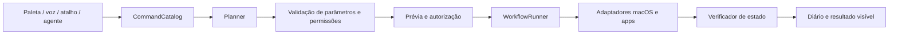

# Arquitetura proposta de automação do Sieghart macOS

**Estado:** desenho original, ainda não implementado. Derivado dos contratos públicos estudados em [Raycast](../applications/raycast.md), dos limites de [OpenJarvis](agent-runtime-comparison.md) e do [código atual](../../Sieghart/Shared/Services/Activation/ActivationController.swift). Um protótipo que altere Sieghart deve usar worktree separado da árvore de desenvolvimento ativa.

## Objetivo e fronteiras

Uma solicitação por paleta, atalho, voz ou agente vira a mesma operação tipada. O texto não é executável: nenhuma resposta de LLM pode virar shell, AppleScript, URL arbitrária ou gesto AX sem resolução para um `ActionDescriptor` aprovado. A UI pode fechar sem perder o resultado da ação curta; tarefas longas e agendadas exigem projeto próprio de persistência e ciclo de vida.



## Contratos Swift propostos

Nomes e assinaturas são **propostas de design**, não APIs já presentes no repositório. Cada tipo de entrada/saída de actor cruza fronteiras de concorrência como `Sendable`.

```swift
struct CommandDescriptor: Sendable, Identifiable {
    let id: String
    let title: String
    let aliases: [String]
    let category: CommandCategory
    let inputSchema: ActionInputSchema
    let risk: ActionRisk
    let requiredCapabilities: Set<Capability>
}

struct ActionRequest: Sendable {
    let actionID: String
    let input: ActionInput
    let origin: ActionOrigin // palette, voice, hotkey, agent, schedule
    let taskID: UUID
    let idempotencyKey: String?
}

enum ActionState: Sendable {
    case planned, awaitingPermission, awaitingApproval, running
    case succeeded(ActionReceipt), failed(ActionFailure), cancelled
    case unverified(ActionReceipt)
}

protocol ActionAdapter: Sendable {
    var descriptor: CommandDescriptor { get }
    func preview(_ request: ActionRequest) async throws -> ActionPreview
    func execute(_ request: ActionRequest) async throws -> ActionReceipt
    func verify(_ receipt: ActionReceipt) async -> VerificationResult
}

protocol ActionAuthorizing: Sendable {
    func decision(for preview: ActionPreview, origin: ActionOrigin) async -> AuthorizationDecision
}

actor CommandCatalog { /* descriptors and search index */ }
actor WorkflowRunner { /* task state, cancellation, journal */ }
```

`ActionInput` deve ser enum/estrutura codificável por ação, com validação de formato e limites. Não usar `[String: Any]` no caminho de autorização. `ActionReceipt` traz alvo, horário, efeito observado e informação suficiente para verificação; segredos não entram no diário. IDs permanecem estáveis quando o rótulo muda. O registro pode oferecer descritores às três superfícies sem expor objetos de UI dentro do core.

## Ciclo de vida de uma ação

1. **Descobrir:** busca em memória retorna comandos e apps conhecidos sem iniciar dependências pesadas. Índice de arquivos é serviço separado e opcional. A ordenação inicial pode combinar prefixo, alias, frequência local e contexto explícito; não usar dados ocultos do app em primeiro plano sem consentimento.
2. **Planejar:** `Planner` gera passos tipados e dependências. A saída de modelo é tratada como sugestão; o host valida identificadores, parâmetros e limite de passos. Um comando manual pode pular o modelo.
3. **Prévia:** cada adaptador apresenta alvo e efeito. Ex.: “Abrir Xcode”, “Mover janela do Obsidian para a direita”, “Executar Atalho Trabalho”. Mostrar o que depende de Accessibility, Apple Events ou Atalhos.
4. **Autorizar:** política do host considera risco, origem, escopo e aprovação recente. Leitura local baixa pode seguir sem diálogo conforme preferência; escrita sensível, dados pessoais, envio externo, shell e alterações de sistema recebem aprovação específica. Aprovação vincula `actionID`, parâmetros canônicos e validade curta, de forma que um modelo não possa trocar o alvo depois.
5. **Executar:** `WorkflowRunner` usa `Task` estruturada, deadline por passo e concorrência só entre passos independentes. Mantém estado fora do `@MainActor`; UI publica snapshots no `@MainActor`. Para AX/AppKit, chamar um adaptador isolado no main actor somente nas operações que exigem esse contexto.
6. **Verificar:** comparar `ActionReceipt` com estado acessível. Sucesso, falha, cancelamento e “iniciado, sem confirmação” são estados diferentes. A Promise de [`launchCommand`](https://developers.raycast.com/api-reference/command) no Raycast, por exemplo, documenta apenas início, mostrando por que essa separação é necessária.
7. **Registrar:** diário local por tarefa com evento, status, duração e erros categorizados; detalhes sensíveis redigidos ou omitidos. Retenção configurável, exportação para diagnóstico só com escolha do usuário.

## Permissões e adaptadores macOS

| Ação | API pública inicial | Permissão/limite | Verificação sugerida |
| --- | --- | --- | --- |
| Abrir app | [`NSWorkspace.openApplication`](https://developer.apple.com/documentation/appkit/nsworkspace/openapplication%28at%3Aconfiguration%3Acompletionhandler%3A%29) | Validar app selecionado/bundle ID; resultado do launch não é prontidão funcional | `NSRunningApplication`, ativação e, se necessário, janela visível |
| Abrir URL/documento | `NSWorkspace.open` | Confirmar esquema e destino; links não são ferramenta genérica para efeitos sem prévia | App aberto/retorno da API; páginas externas normalmente não são verificáveis |
| Ler/mover janela | [`AXUIElement`](https://developer.apple.com/documentation/applicationservices/axuielement) | Accessibility consentido; app pode não expor atributo ou rejeitar valor | Ler novamente posição/tamanho; devolver erro AX específico |
| Automatizar app com Apple Events | Interface de script documentada do app, `NSAppleEventsUsageDescription` e entitlement aplicável | Aprovação TCC por destino; não interpolar texto livre em script | Resposta do app e leitura posterior quando possível |
| Executar Atalho escolhido | [`shortcuts` CLI](https://support.apple.com/en-au/guide/shortcuts-mac/apd455c82f02/mac) ou [URL scheme](https://support.apple.com/en-au/guide/shortcuts-mac/apd624386f42/mac) | Atalho pré-existente e consentido; pode solicitar dados/permissão própria | Saída do Atalho/estado do sistema quando observável |
| Expor ação Sieghart à app Atalhos | [`AppIntent`](https://developer.apple.com/documentation/appintents/appintent) | App Intents funcionam no macOS; [App Shortcuts automáticos não](https://developer.apple.com/design/human-interface-guidelines/app-shortcuts) | Atalho personalizado na app Atalhos e teste manual |

Não inferir capacidade de ligar Focus do sistema a partir de [`SetFocusFilterIntent`](https://developer.apple.com/documentation/appintents/focus): ele adapta o **Sieghart** ao Focus ativado. Para o exemplo do ambiente de desenvolvimento, só incluir o passo de Focus se um Atalho do usuário ou outra interface pública de ativação for validada no Mac alvo.

## Workflow “preparar ambiente de desenvolvimento”

**Entrada validada:** Xcode e Obsidian escolhidos pelo usuário, layout simples e Atalho de Focus opcional. O plano exibe cada etapa antes de executar. Abrir apps pode prosseguir como ação reversível. Mover janelas exige Accessibility e prévia. Executar o Atalho escolhido exige aprovação da ação e pode abrir seu próprio diálogo. Um passo negado não gera alegação de sucesso; passos independentes podem continuar se o plano original permitir. Resumo final: “Xcode aberto; Obsidian aberto; janelas organizadas; Focus não executado (Atalho indisponível)”.

Falha de abertura pode receber **um** retry curto após confirmar que o app existe; criação de arquivo, envio externo ou ação de sistema não recebe retry automático sem idempotência. Cancelamento impede novos passos e registra efeitos já concluídos. Compensar exige ação explícita; “desfazer” genérico não é prometido.

## Integração com a implementação atual

[`ActivationController`](../../Sieghart/Shared/Services/Activation/ActivationController.swift) já contém registro de atalhos e fluxo de voz com parser determinístico; [`LocalAppLauncher`](../../Sieghart/Core/Helpers/VoiceCommands.swift) abre apps por `NSWorkspace`. A primeira implementação deve extrair descritores e execução dessas funções por adaptação progressiva, preservando comportamento. `PaletteViewModel` usa `CommandCatalog`; o parser de voz mapeia para `ActionRequest`, enquanto o agente só recebe descritores permitidos. As interfaces de Codex/Claude atuais, focadas em codificação, podem ser ferramentas ou vistas próprias, sem tornarem-se automaticamente a autoridade sobre apps e sistema.

## Ensaios para uma futura implementação isolada

Usar worktree próprio antes de editar código. Criar um conjunto pequeno e reproduzível: buscar comando por título/alias, abrir app instalado, tentar app ausente, negar Accessibility e confirmar que não ocorre movimento, conceder e organizar uma janela, cancelar entre passos, repetir plano e conferir idempotência, provocar timeout do Atalho e conferir “não confirmado”. Testar com dois monitores, app em fullscreen, janela que não aceita resize e atalho global conflitante. Coletar tempos de invocação, primeiro resultado, memória e energia no Mac real; definir metas após baseline, sem inventar números do Raycast. Entregar ao usuário passos exatos para reproduzir e reverter permissões.

## Questões de manutenção

Automação de UI por AX é dependente do app/versão e pode falhar mesmo com permissão. Scripts genéricos ampliam superfície de risco; suporte somente a integrações declaradas. Registro de extensões externas ou execução de código de terceiros fica fora do MVP. Se houver tarefas agendadas que precisam sobreviver ao encerramento, estudar [`SMAppService`](https://developer.apple.com/documentation/servicemanagement/smappservice) e aprovação de Login Item/LaunchAgent; um timer do processo principal não fornece essa garantia.
